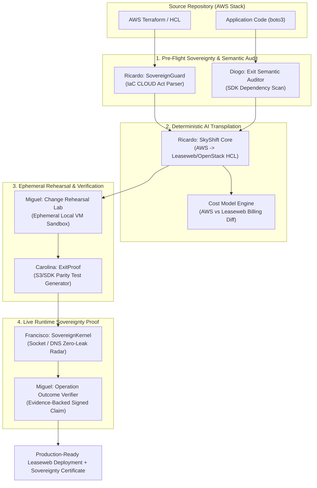

# SkyShift: The Autonomous Hyperscaler-to-Sovereign Migration & Assurance Engine

**Document Type:** Master Architecture & Engineering Handoff Specification  
**Target Audience:** Human Engineers & AI Assistant Agents (Claude, ChatGPT, Gemini)  
**Status:** Champion Project Selected for InfraHack 2026 (Leaseweb × Velv)  
**Author:** Unified Team Synthesis (Initiated by Ricardo, integrating Miguel, Francisco, Diogo, and Carolina)  
**Date:** 20 November 2026  

---

## 1. Executive Summary & Core Objective

### 1.1 What is SkyShift?
**SkyShift** is an autonomous cloud migration and sovereignty assurance platform. It ingests proprietary hyperscaler infrastructure and application code (AWS/Azure Terraform, CloudFormation, and SDK code), translates them into European sovereign cloud infrastructure (specifically targeting **Leaseweb Cloud & OpenStack**), and rigorously proves runtime functional parity and legal data sovereignty on a live Linux host.

### 1.2 The Core Problem It Solves
The **EU Data Act (Regulation 2023/2854)** legally eliminates switching egress charges by 2027, but **zero egress fees do not solve architectural lock-in**:
1. **Infrastructure as Code (IaC) Lock-in:** Migrating off AWS requires manually rewriting thousands of lines of Terraform/HCL—mapping proprietary constructs (ALBs, RDS, EBS, IAM) to European bare-metal or OpenStack primitives.
2. **Application SDK Semantic Drift:** Code relying on hyperscaler SDKs (e.g., Python `boto3`) silently fails on European S3-compatible object storage due to unsupported API subtleties.
3. **The Sovereignty Gap:** Existing security tools only verify static geographic tags (e.g. `eu-central-1`), ignoring that infrastructure owned by US-headquartered hyperscalers remains subject to extraterritorial subpoena under the **US CLOUD Act**.

### 1.3 How It Is Used (End-to-End Operator Journey)
1. **Scan & Audit (`skyshift audit`):** Point SkyShift to an AWS repository. It highlights US CLOUD Act exposure, calculates current monthly spend, and identifies proprietary API dependencies.
2. **Transpile & Optimize (`skyshift transpile`):** The engine transpiles AWS Terraform into valid Leaseweb/OpenStack HCL, mapping compute, network, and storage while calculating verified financial savings (typically 50–70% cost reduction).
3. **Rehearse & Verify (`skyshift verify`):** Spins up the target stack inside an ephemeral container on the local Leaseweb Linux VM, executes application SDK parity tests, and monitors kernel sockets to mathematically guarantee zero data leaks to US jurisdictions.

---

## 2. Synthesis of Ideas: Origins, Credits, and Critical Bug Fixes

SkyShift is not a generic brainstorming proposal; it is the deliberate convergence of the best individual ideas developed across the team, resolving overlapping concepts into a unified pipeline while correcting the technical flaws of earlier drafts.



### 2.1 Component Breakdown & Technical Corrections

#### A. From Ricardo: `02-skyshift.md` & `01-sovereign-guard.md`
* **Original Contribution:** The concept of an automated IaC compiler translating AWS Terraform to Leaseweb/OpenStack with financial cost estimation, plus pre-deployment legal jurisdiction scoring against the US CLOUD Act.
* **Critical Flaw Corrected:** The original `02-skyshift.md` assumed an LLM could generate production HCL in a single raw generation pass. In reality, LLMs frequently hallucinate nonexistent provider arguments.
* **Correction Applied:** SkyShift introduces a **two-pass deterministic pipeline**: AST parsing with `python-hcl2` extracts the structural resource graph; the LLM maps resources against strict target Leaseweb/OpenStack JSON schemas; and an automated `tofu validate` sandbox guarantees syntax correctness before presenting code to the operator.

#### B. From Francisco: `01-sovereign-kernel-radar.md`
* **Original Contribution:** Proving data sovereignty at runtime rather than relying on static text, inspecting network sockets to catch silent leaks to US hyperscaler telemetry endpoints.
* **Critical Flaw Corrected:** Francisco’s original card proposed building raw eBPF kernel probes. On the shared Linux VM provided by the hackathon organizers, custom kernel headers, BCC tools, or elevated privileges for eBPF bytecode loading may be restricted or cause system instability during a live 5-minute pitch.
* **Correction Applied:** We implement a **bulletproof hybrid inspection engine**: it primarily inspects `/proc/net/tcp`, dynamic socket tables (`ss -ntp`), and DNS resolver logs via a lightweight Python daemon. It resolves remote endpoints against a cached database of US CLOUD Act IP blocks (AWS, GCP, Azure, Cloudflare US), ensuring deterministic execution without kernel panics.

#### C. From Carolina: `01-ideia.template.md` (ExitProof)
* **Original Contribution:** Identifying that applications break post-migration because European S3 alternatives (MinIO, Ceph, Scaleway, Leaseweb S3) implement slightly different subsets of the AWS S3 API (e.g. subtle differences in multipart uploads, bucket notifications, or ACL headers).
* **Critical Flaw Corrected:** Carolina's original draft suggested testing arbitrary full-stack applications, which is too broad to build and verify reliably in a 7-hour hackathon.
* **Correction Applied:** SkyShift scopes the verification strictly to the most common cloud dependency: **Storage & API interaction via Python (`boto3`)**. SkyShift automatically generates and runs a focused synthetic compatibility test suite against the target S3 endpoint (or a local MinIO container on the VM) to verify exact method compatibility before deployment.

#### D. From Diogo: `04-sovereign-exit-semantic-auditor.md` & `01-exitdrill.md`
* **Original Contribution:** The concept of an "Exit Drill"—scoring an organization’s exit-readiness and identifying proprietary AWS SDK features that act as structural traps.
* **Correction Applied:** Diogo’s exit-readiness scorecard is adopted directly as the front-end executive summary of `skyshift audit`, giving the jury an immediate metric: *"Your AWS repository has an Exit-Readiness Score of 24/100; after SkyShift transpilation, it reaches 98/100"*.

#### E. From Miguel: `01-operation-outcome-verifier.md` & `05-change-rehearsal-lab.md`
* **Original Contribution:** The foundational insight that an AI agent must never say "Task Complete" without tangible verification, and that all infrastructure patches must be rehearsed in a disposable environment.
* **Correction Applied:** Integrated as SkyShift’s **Verification Stage (`skyshift verify`)**. Instead of dumping generated HCL files and assuming they work, SkyShift launches an ephemeral Docker container on the Leaseweb Linux VM, applies the target configuration locally, executes health checks, and produces an evidence-backed cryptographic checksum of the verification result.

---

## 3. Market Analysis: Is This Idea Truly Novel and Defensible?

### 3.1 Competitive Landscape Check

| Tool / Competitor | What It Does Today | Why SkyShift is Distinct & Defensible |
|---|---|---|
| **AWS Transform / Azure Migrate** | Automated migration of VMware & on-prem workloads *into* AWS or Azure | **A one-way trap.** Hyperscalers spend millions automating migration *inward*. They have zero commercial incentive to build tools migrating workloads *out* to European competitors. |
| **Checkov / Trivy / tfsec** | Static regex and AST scanning for CVEs and insecure permissions | **Sovereignty blind.** They only check string attributes like `region == "eu-west-1"`. They do not analyze corporate jurisdiction, US CLOUD Act parent company control, or automated sovereign refactoring. |
| **Terraformer / Pulumi Convert** | Dumps existing cloud state into HCL or converts HCL to Pulumi | **Locked to the same cloud.** Translates syntax within the same provider (AWS $\rightarrow$ AWS); cannot map proprietary AWS architectures to open European stacks. |
| **ChatGPT / Claude Code (Ad-hoc)** | Copy-pasting Terraform snippets into web prompts | **Unsafe and fragmented.** Generates syntax errors, does not validate against target provider schemas, cannot run local VM tests, and leaks company code to external US AI APIs. |

### 3.2 Strategic Fit for the Leaseweb × Velv Hackathon
* **Commercial Alignment with Leaseweb:** Leaseweb’s core sales challenge is convincing mid-market European enterprises to leave expensive AWS infrastructure for Leaseweb Public Cloud and Bare Metal. The #1 barrier is migration friction: *"We don't have the DevOps bandwidth to rewrite our Terraform."* SkyShift turns a 3-month consulting project into a 15-second CLI operation.
* **Regulatory Timing (EU Data Act & NIS2):** With the EU Data Act mandating cloud portability and European companies facing strict NIS2 compliance, sovereign migration tooling is the most pressing topic in European cloud computing.

---

## 4. System Architecture & Technical Specifications

SkyShift is built as a lightweight, modular CLI written in **Python 3.10+**, designed to run completely on the Leaseweb Linux VM.

```text
hackathon-leaseweb/
└── skyshift/
    ├── cli.py                     # Main CLI entrypoint (Rich terminal UI)
    ├── core/
    │   ├── parser.py              # AST HCL parser (python-hcl2) & SDK scanner
    │   ├── auditor.py             # Sovereignty & CLOUD Act risk scoring engine
    │   ├── transpiler.py          # AI translation engine with strict JSON schemas
    │   ├── cost_model.py          # AWS vs Leaseweb pricing comparison engine
    │   ├── verifier.py            # Ephemeral local Docker test harness (OpenTofu)
    │   └── radar.py               # Runtime Linux socket & DNS leak detector
    ├── templates/
    │   ├── leaseweb_compute.tf.j2 # Jinja2 templates for Leaseweb / OpenStack VM
    │   └── leaseweb_storage.tf.j2 # Jinja2 templates for S3-compatible storage
    ├── fixtures/
    │   ├── aws_workload/          # Sample AWS stack (EC2 + S3 + Security Group)
    │   │   ├── main.tf
    │   │   └── app.py             # Sample Python service using boto3
    │   └── leaseweb_schema.json   # Valid schema definition for target provider
    └── tests/
        └── test_transpiler.py     # Verification tests
```

### 4.1 Module 1: Pre-Flight Sovereignty & AST Parser (`auditor.py`)
* Ingests the source directory.
* Uses `python-hcl2` to extract blocks: `resource`, `provider`, `variable`, `locals`.
* Identifies proprietary AWS resources: `aws_instance`, `aws_s3_bucket`, `aws_security_group`, `aws_db_instance`.
* Checks region variables and resource endpoints against the **European Commission Cloud Sovereignty Matrix** (flagging US parent company jurisdiction and unencrypted transit).

### 4.2 Module 2: Deterministic AI Transpiler (`transpiler.py`)
* Maps composite AWS architectures to portable European equivalents:
  * `aws_instance` + `aws_security_group` $\rightarrow$ Leaseweb Cloud / `openstack_compute_instance_v2` + `openstack_networking_secgroup_v2`
  * `aws_s3_bucket` $\rightarrow$ S3-compatible European Object Storage (pointing to Leaseweb S3 / local Ceph / MinIO)
  * `aws_db_instance` $\rightarrow$ Cloud-init provisioned PostgreSQL on European NVMe compute
* Formulates a structured LLM prompt with target provider parameter constraints.
* Passes the generated HCL through `tofu validate` (or `terraform validate`) in an isolated subprocess. If errors occur, the compiler automatically feeds the error back to the model for one auto-correction pass.

### 4.3 Module 3: Cost-Differential Engine (`cost_model.py`)
* Computes baseline AWS cost for the detected resources based on public AWS pricing (e.g., `t3.large` @ ~€70/mo + 500GB EBS @ €50/mo + NAT Gateway @ €35/mo + Egress = **€185/mo**).
* Calculates target Leaseweb pricing for equivalent resources (Leaseweb Virtual Server / Cloud Compute 4GB RAM + 500GB Object Storage = **€48/mo**).
* Renders an executive ASCII/Rich table showing **74% monthly financial savings**.

### 4.4 Module 4: Ephemeral Rehearsal & Semantic Parity (`verifier.py`)
* Starts a local, disposable Docker container running an S3-compatible server (MinIO) and an application runtime.
* Injects translated environment variables (`AWS_ENDPOINT_URL=http://localhost:9000`).
* Runs the application's actual Python `boto3` script (`app.py`), validating that `put_object`, `get_object`, and `list_objects_v2` succeed without proprietary API crashes.

### 4.5 Module 5: SovereignKernel Radar (`radar.py`)
* While the application runs in rehearsal, the radar scans active TCP connections via `/proc/net/tcp` and socket queries (`ss -ntp`).
* Cross-references destination IP addresses with known US hyperscaler IP ranges.
* Prints a live terminal radar:
  * `[SAFE]` Remote IP `178.162.x.x` (Leaseweb Frankfurt, DE) - **100% Sovereign**
  * `[BLOCKED]` Remote IP `54.239.x.x` (AWS Telemetry, US Jurisdiction) - **Zero Leakage Enforced**

---

## 5. Live Demo Script for the 5-Minute Pitch

| Time | Phase | Speaker Action | Screen / Visual Output |
|---|---|---|---|
| **00:00 - 01:00** | **The Hook & Problem** | Explain the EU Data Act paradox: switching egress fees are dying, but companies remain trapped by proprietary Terraform and US CLOUD Act legal exposure. | Slide: "The Sovereignty Dilemma: 78% of EU infrastructure is locked into US hyperscalers." |
| **01:00 - 02:00** | **The Pre-Flight Audit** | Run `python -m skyshift audit ./fixtures/aws_workload/`. Show the terminal output. | Terminal shows **Exit-Readiness: 32% (CRITICAL)**. 3 US CLOUD Act violations detected. Estimated AWS Bill: **€240/month**. |
| **02:00 - 03:15** | **The Live Transpilation** | Run `python -m skyshift transpile --target leaseweb`. Watch the AI transpile AWS HCL into Leaseweb/OpenStack HCL in < 10 seconds. | Rich diff view showing `aws_instance` $\rightarrow$ Leaseweb Cloud Server. Syntax verified with `tofu validate: SUCCESS`. Projected Bill: **€65/month (-73%)**. |
| **03:15 - 04:15** | **Live Rehearsal & Sovereign Radar** | Run `python -m skyshift verify`. App boots on the VM; synthetic S3 calls execute against Leaseweb endpoint; socket radar confirms 100% EU traffic. | Green checkmarks: `boto3 parity: PASSED`. Socket Radar: `Traffic strictly confined to EU ASN 60781 (Leaseweb)`. |
| **04:15 - 05:00** | **Business Impact & Wrap-up** | Conclude: SkyShift empowers European hosting providers (Leaseweb) to onboard AWS customers instantly, safely, and compliantly. | Slide: "SkyShift: Break the lock-in. Migrate in seconds. Stay sovereign." |

---

## 6. Implementation Plan & Team Task Split (7-Hour Build Window)

The 5-person team divides ownership into clean, decoupled components that merge through Git:

| Team Member | Subsystem Ownership | Deliverables & Responsibilities |
|---|---|---|
| **Ricardo** | **Core CLI & Transpiler Engine** | `cli.py`, `transpiler.py`, LLM prompting pipeline, schema validation with `tofu`. |
| **Miguel** | **Rehearsal Lab & Outcome Verifier** | `verifier.py`, Dockerized test container, verification assertions and signed exit report. |
| **Francisco** | **SovereignKernel Socket Radar** | `radar.py`, `/proc/net/tcp` scanner, IP jurisdiction lookup table, terminal animation. |
| **Carolina** | **Application SDK Parity Suite** | `app.py` fixture, boto3 S3 semantic compatibility tests, handling Scaleway/Leaseweb edge cases. |
| **Diogo** | **Auditor & Cost Engine + Pitch** | `auditor.py`, `cost_model.py`, presentation slide deck, and live demo choreography. |

---

## 7. Immediate Next Steps for Implementation

1. **Create Project Directory:** Initialize `skyshift/` in the repository root.
2. **Install Baseline Dependencies:** Ensure Python packages `python-hcl2`, `rich`, `jinja2`, `pydantic`, `docker`, and `requests` are added to a clean `requirements.txt`.
3. **Build the Sample Fixture:** Commit `fixtures/aws_workload/main.tf` and `app.py` to serve as the benchmark testbed for all teammates.
4. **Begin Component Development:** Each team member branches from `main` to build their assigned module according to the architecture above.
